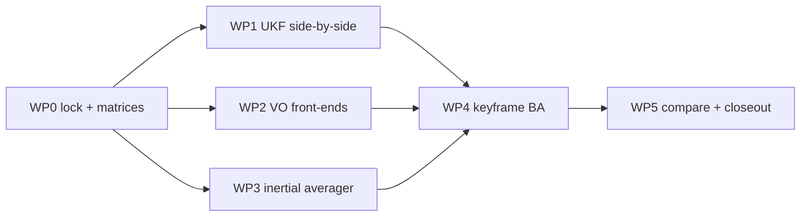

# Localisation improvement plan

> Code is truth — everything below is planned, not present.
> Status: **DRAFT pending owner review.**
> No JSF AV or ECSS compliance or certification is claimed for any
> work below. New modules target ECSS-flavoured rigor only
> (traceability, rationale, verification), with criticality
> unassigned — see the
> [criticality rationale](../../compliance/feature_tracking/CRITICALITY_RATIONALE.md).
> Tuning values marked *proposed* are starting points for
> implementation, not authority; authority lives in the YAML/source
> linked on `main`.

Purpose: four independent localisation threads — side-by-side UKF,
visual front-end options, inertial averaging experiment, and a
sliding-window keyframe bundle adjustment — each comparable against
the current stack via bags and ground truth.

Where (new code will live): `src/localisation/` for shared
engines plus `src/systems/alpha/alpha_localisation/` for Alpha
wrappers
([GitHub](https://github.com/richarJ2002/space_robotics_simulator/blob/main/src/localisation/)).

## Baseline (links win on conflict)

- ESKF: 16 nominal + 15 error states, raw-IMU prediction, NIS-gated
  visual/wheel correction with checkpoint rollback and replay —
  see [Localisation filter](../../systems/alpha/localisation-filter.md)
  and the [Kalman engine](kalman-engine.md).
- IMU path is 1:1 with no averaging: Gazebo → bridge → driver noise
  → `/alpha/imu` at the plugin rate — see
  [Inertial odometry](inertial-odometry.md) and
  [Drivers](../../systems/alpha/drivers.md).
- VO is Shi-Tomasi + pyramidal Lucas-Kanade under the
  `feature_tracking/` JSF AV applicability profile (`PROPOSED`,
  pending owner sign-off) — see
  [Visual odometry](visual-odometry.md).
- Params live under `parameters/systems/alpha/` with the top-level
  key equal to the registered node name; C++ follows `objects/` +
  `methods/` with one overload per `.cc`; logs use `SRS_LOG_*` only;
  machine-readable state goes on `/alpha/diagnostics`.

## Locked decisions

1. **UKF** ships side-by-side with the ESKF for A/B comparison; the
   ESKF stays default until a paired comparison justifies a switch.
2. **VO** gains a `feature_methods/` level holding multiple
   front-ends; the current engine moves untouched to its own
   subpackage. The `feature_tracking/` JSF scope is preserved
   (preferred: keep the path; a rename lists the full move set —
   see WP2).
3. **Inertial** splits into `inertial_odometry_node/` plus a sibling
   `inertial_averaging/` experiment with a clean IMU-in /
   filtered-IMU-out boundary; Alpha wires raw vs averaged at system
   level. Either the averager replaces the LPF with retune evidence
   or it is dropped — both are never shipped tuned differently.
4. **Keyframe BA** is full bundle adjustment (poses + landmarks),
   Eigen-only, source-agnostic keyframes (pose + covariance, no
   assumed producer), configurable window, exact output list in WP4,
   verified against simulator ground truth. No loop closure or map
   merging.

## Decision matrices (fill before coding each track)

| Candidate | Value 0-5 | Time incl. tests/docs | Risk L/M/H + why | Verdict now/later/never |
|---|---|---|---|---|
| *rows per track below* | | | | |

- UKF rows: keep ESKF / dual compare / switched rerun.
- VO rows: baseline keep / ORB+LK / GFTT-variants / AKAZE /
  SuperPoint+LightGlue-ONNX.
- Inertial rows: tune LPF / windowed-mean N / time-window ms.
- Keyframe trigger rows: count-N / time-window / offline-first.
- Rule: cheapest value/time with `L` risk first; deferred rows are
  marked `deferred: <condition>`.

## WP0 — Baseline lock + matrices (no behaviour change)

Files: this plan's matrix tables in
[index](index.md),
[kalman-engine](kalman-engine.md),
[visual-odometry](visual-odometry.md),
[inertial-odometry](inertial-odometry.md);
empty unwired dirs optional with recorded expiry (remove if still
unwired after WP1), or omitted entirely. No `src/`, `parameters/`,
`launch/`, or `config/` touches; no topics, no YAML, no new tests.

Verify: `colcon build`, `colcon test`, `launch_test.sh`,
`mkdocs build --strict`. Baseline recorded as commit SHA plus the
`parameters/` snapshot at implementation start. Stop if the build is
red or the `/clock` count in domain 73 is not exactly one.

## WP1 — UKF side-by-side

- New ROS-free engine
  `src/localisation/kalman_filter/ukf_continuous_kalman_filter/`
  (namespace
  `localisation::kalman_filter::ukf_continuous_kalman_filter`,
  `Eigen3::Eigen` only): one type per header, one overload per
  `.cc`, `p_` / `_in` / `_out` / `_inout`, full Doxygen.
- New Alpha wrapper sibling of `AlphaKalmanFilterNode`, e.g.
  `src/systems/alpha/alpha_localisation/alpha_ukf_filter/`
  (namespace `systems::alpha::alpha_localisation::alpha_ukf_filter`,
  `objects/` + per-class `methods/`, `<verb><Noun>CallBack`)
  with `Node("continuous_ukf")` owning the engine — the engine
  itself is never `add_node`'d (it is library-only, like the EKF
  engine). `AlphaNode` holds it as a member and calls
  `executor.add_node()` (default callback group), mirroring every
  existing node.
- Build wiring in the same change:
  `kalman_filter/CMakeLists.txt` (`add_subdirectory`),
  `localisation/CMakeLists.txt` (as needed),
  `src/systems/alpha/alpha_localisation/CMakeLists.txt`
  (`add_subdirectory`) + `alpha_node` target linkage (both new
  targets carry `install(TARGETS … ARCHIVE DESTINATION lib)`
  like every localisation lib), and the
  `AlphaNode` wiring above —
  otherwise `colcon build` silently builds the old tree.
- Topics use `system_name`-rooted defaults:
  `/<system>/localisation/ukf/odometry` plus
  `/<system>/localisation/ukf/path`
  (path output excluded from recording per the existing retained-`Path`
  policy, like the EKF/ground-truth paths). Never TF. QoS mirrors
  the EKF (odometry `QoS(10)`, path
  `QoS(1).reliable().transient_local()`, subs `SensorDataQoS`;
  `rosbag_qos.yaml` iff differs).
- New
  `parameters/systems/alpha/alpha_localisation/alpha_ukf_filter.yaml`
  (top key `continuous_ukf`) + `launch/alpha_launch.py` 10th entry, plus the
  full record/sync set in the same change (including the stale
  `9 files` comment + node-list docstring in `alpha_launch.py`,
  `9→10` files (reconciling the docstring with the 9 existing
  `add_node` calls including the omitted `estimate_low_pass_filter`,
  then adding `continuous_ukf`):
  recorder suffixes in `launch_simulator.sh`, `topic_registry.py` entries,
  `launch_test.sh` required-file + node-key asserts (`9→10`) and
  recomputed counts (expected 24 core incl `/clock`, 27
  core+images, manifest length 24), and a `rosbag_qos.yaml` entry iff
  QoS differs from the recorder default — otherwise the new topics
  break the sync test and are silently unrecorded.
- UKF subscribes to raw `/<system>/imu` plus the same visual/wheel
  defaults as the EKF; never to `filtered_imu` or any
  `ground_truth` topic.
- Wrapper duplicates the 0.02 s substep bound and the 99%
  chi-square gate values (currently a `predictTo.cc`-local bound
  and a `selectNisThreshold.cc`-local `CHI_SQUARE_99_PERCENT`
  table — promote to a shared header if shared) with an explicit
  UKF `P_yy` / dimension
  mapping plus sigma parameters; `RelWithDebInfo` timing
  evidence at 50 Hz IMU plus rollback-replay before claiming
  parity.
- `startup_supervisor.yaml` and supervisor defaults unchanged
  (comparison-only, never gates READY). New `continuous_ukf*`
  diagnostics either gain a `bag_diagnostics.py` parser + test or a
  recorded documented-ignore in the same change.
- Tests: `test_ukf_math` beside `test_kalman_math.cpp`
  (sigma-point recovery, linear-case EKF agreement) with its
  `test/CMakeLists.txt` (`ament_add_gtest` + include/link) entry
  in the same change — otherwise the test never builds or runs;
  headless circle run comparing ESKF vs UKF vs ground truth, gated
  on UKF circle ATE within 10% of ESKF on the same bag; RPE is
  gated only after its work item lands (new fixed-window
  translational/rotational RMSE tool + window/length definition +
  board/dataset, in `post_processing/` with unit tests).
- Docs: kalman-engine + Alpha filter pages with
  purpose/topics/key-files/params/diagram + GitHub links in the
  same change.

## WP2 — VO `feature_methods/`

- Preferred: keep the `feature_tracking/` path unchanged and
  restructure the wrapper only — zero compliance churn, `-Werror`
  and dependency-free invariants preserved, all 8 deviations stay
  `TODO(project)`.
- A rename instead lists the complete move set: all three
  `CMakeLists` (`visual_odometry/` including its
  `install(TARGETS…)`, `feature_tracking/`,
  `visual_odometry_node/`),
  every engine `#include`, `VisualOdometryNodeClass.h` includes,
  `test/CMakeLists.txt` include/link, `AGENTS.md` overlay clause,
  all five compliance documents plus `docs/compliance/index.md`,
  the root `CMakeLists.txt` RelWithDebInfo comment path, and every
  `visual_odometry::feature_tracking` namespace qualification
  (6 engine headers, VO node methods, all 3 test files — the
  namespace must follow the directory per the mirror rule), with
  `-Werror` + init / no-heap / checked-status properties
  re-proven.
- No one-implementation `FeatureDetector` base; single default
  callback group retained; `selectKeyframeAction` semantics
  unchanged; existing VO GTests byte-identical in the move-only
  step; `console_logging_lint` green.
- Docs: visual-odometry page with
  purpose/topics/key-files/params/diagram + GitHub links in the
  same change (`src/localisation/visual_odometry/` + key-files
  paths), plus profile §1 applicability paths and
  traceability-matrix design-element/test-case mappings for moved
  files.

## WP3 — Inertial split + averager

- Current node moves to `inertial_odometry_node/` (target name
  kept); `src/localisation/CMakeLists.txt` rewired in the same
  change (`add_subdirectory(inertial_odometry_node)` replacing
  `inertial_odometry` + `add_subdirectory(inertial_averaging)`);
  `test/CMakeLists.txt` include path follows (averager reuses the
  `NOT_INITIALIZED`/`INVALID_CONFIGURATION` status pattern with
  named empty-window + overflow values); new params
  declared in the Node ctor (top key stays `inertial_odometry`).
- New `inertial_averaging/` library with
  `push(raw_imu_in, filtered_imu_out)` boundary, fixed-cap O(1)
  window, no allocation in the hot path.
- Selector param `use_averaged_imu` (default `false`, raw path
  unchanged) under the existing `inertial_odometry` top key;
  without it the averaged mode cannot be exercised.
- Specify order: calibrate on raw, then average bias-corrected
  (or the reverse with retune evidence). Single Node, single
  callback group, single `inertial_odometry` status; diagram and
  params in `inertial-odometry.md` updated in the same change.
- New averager diagnostics follow the §WP1 parser-or-ignore rule.
- Docs: inertial-odometry page with
  purpose/topics/key-files/params/diagram + GitHub links in the
  same change.
- Tests: `test_inertial_averager` (mean/variance, jitter guard,
  overflow-drops-oldest within the 32-sample cap with its
  `test/CMakeLists.txt` (`ament_add_gtest` + include/link) entry
  in the same change — otherwise the test never builds,
  empty-window status); default-raw headless regression, then
  averaged bag comparison.

## WP4 — Keyframe Full BA (Eigen-only)

- New `src/localisation/keyframe_local_optimization/`, namespace
  `localisation::keyframe_local_optimization`, one type per header
  (`KeyframeWindow`, `BundleAdjustmentOptimizer`,
  status enum, source-agnostic `KeyframeSample` with pose +
  covariance, `KeyframeLocalOptimizationNode` with
  `Node("keyframe_local_optimization")`), per-class
  `methods/<Class>/` dirs, one overload per `.cc`,
  `<verb><Noun>CallBack` spelling.
- Engine ROS-free returning `[[nodiscard]]` status; Node ctor
  throws on invalid params. Heap sized in `initialize()` only:
  fixed-size Eigen types with compile-time caps (à la
  `MAXIMUM_SUPPORTED_FEATURES`) and no post-`initialize()`
  allocation — any deviation needs an explicit recorded deviation
  with bound + verification; pre-init calls return
  `NOT_INITIALIZED`; `terminate()` releases.
- All tuning via new
  `parameters/systems/alpha/alpha_localisation/keyframe_local_optimization.yaml`
  (top key `keyframe_local_optimization`, matching
  `Node("keyframe_local_optimization")`) — *proposed*:
  `window_size` 5, `max_iterations` 10, Huber on,
  `trigger_mode` `count|time|offline-first` (count = keyframes),
  `input_source` `visual|ekf` default
  visual, plus `system_name`, `input_odom_topic`,
  `input_cloud_topic`, `output_odom_topic`,
  `output_cloud_topic`, `output_feature_topic` (defaults = the
  three exact output topics below), `odom_frame` default
  `systemName + "/startup_fixed"` (e.g. `alpha/startup_fixed`),
  `base_frame` literal `alpha/base_link`, `diagnostics_topic`
  default `/<system>/diagnostics`, and
  `input_odom_topic` defaults from `input_source`; an inconsistent
  explicit override makes the Node ctor throw; `ekf` selection
  forces pose-only regardless of `input_cloud_topic`. Node ctor
  throws if `window_size == 0` or `> MAX_WINDOW_KEYFRAMES`,
  `max_iterations == 0`, or `trigger_mode`/`input_source` leave
  their allow-lists. Publisher QoS `rclcpp::QoS(10).reliable()` (needing no recorder
  override; `SensorDataQoS` instead requires explicit
  `rosbag_qos.yaml` entries or core topics are silently
  unrecorded), subscriber QoS `SensorDataQoS` mirroring the EKF
  subs, `maximum_input_age_s` default `0.25` and BA-local
  `input_queue_depth` default `2` (value mirrors VO
  `image_queue_depth: 2`). Compile-time caps
  `MAX_WINDOW_KEYFRAMES` (16) and `MAX_LANDMARKS` (16384 = 1024
  hard-cap `MAXIMUM_SUPPORTED_FEATURES` × 16) bound the
  `initialize()`-only heap. Stale selected
  input marks the pose unavailable (VO `KeyframeAction::MARK_POSE_UNAVAILABLE`
  semantics) — never silent coasting.
- Inputs allow-listed with `system_name`-rooted defaults:
  `/<system>/localisation/visual/odometry` or
  `/<system>/localisation/kalman_filter/odometry` for keyframe
  poses, plus `/<system>/localisation/visual/point_cloud` for
  feature observations (poses carry the odometry covariances;
  `PointCloud2` itself has none) paired by `message_filters`
  `ApproximateTime` for pose-cloud pairing (pairing queue depth 2
  plus a 0.25 s post-sync age discard mirroring VO — VO stereo
  itself uses `ApproximateTime` (`StereoPolicy`)) with cloud
  tied to pose source —
  `ekf` pose + visual cloud mixing is forbidden (cross-estimator
  pairing with mismatched drift): `ekf` mode is pose-only (cloud
  subscription and `ApproximateTime` disabled,
  `input_cloud_topic` ignored) until a fused-cloud source exists;
  in `ekf` mode no `point_cloud`/`features` are published (stale
  poses follow the `MARK_POSE_UNAVAILABLE` rule instead);
  `ground_truth/*` and `inertial/filtered_imu` forbidden as
  inputs. Outputs (exact defaults):
  `/<system>/localisation/keyframe_optimized/odometry`,
  `/<system>/localisation/keyframe_optimized/point_cloud`,
  `/<system>/localisation/keyframe_optimized/features`
  (`sensor_msgs/Image`, mirroring `visual/features`; the short
  `keyframe_optimized/*` prefix vs the long node/status name is
  intentional, mirroring `continuous_ekf` vs `kalman_filter/*`),
  plus
  diagnostics — comparison-only, never added to EKF `fuse_*`;
  EKF YAML unchanged. No `map_frame`/`estimated_base_frame`
  (unlike the EKF): no TF broadcast and no `map` re-anchor.
- Wiring in the same change:
  `src/localisation/keyframe_local_optimization/CMakeLists.txt`
  (new target) + `src/localisation/CMakeLists.txt`
  (`add_subdirectory(keyframe_local_optimization)`),
  `src/systems/alpha/alpha_node/CMakeLists.txt`
  (`target_link_libraries`) so the member links, and the new
  package `CMakeLists.txt` carries its
  `install(TARGETS … ARCHIVE DESTINATION lib)` like every
  localisation lib,
  `AlphaNode` member + `add_node` (default callback group),
  `alpha_launch.py` 11th YAML (including its stale N-files comment
  + node-list docstring, `10→11` files with the keyframe node
  added), recorder suffixes +
  `topic_registry.py` (`CORE_TOPICS`/`IMAGE_TOPICS`) +
  `launch_test.sh` required-file list + node-key asserts
  (`10→11` for the keyframe YAML / top key) + §8 record-topic
  asserts + §9 manifest-count assert + `rosbag_qos.yaml`
  iff QoS differs — registering odometry + point_cloud in CORE
  (`nav_msgs/Odometry`/`ODOMETRY`, `sensor_msgs/PointCloud2`/
  `POINT_CLOUD`, `core=True`) and features in IMAGE
  (`sensor_msgs/Image`/`IMAGE`, `core=False`), mirroring
  visual/odometry+point_cloud (core) vs visual/features
  (image-only). Expected after WP4: 26 core (incl `/clock`),
  30 core+images (from WP1 24/27). No TF broadcast, no direct `/clock`
  subscription, no `map` re-anchor; `use_sim_time` timers only.
- Diagnostics follow the §WP1 parser-or-ignore rule; never gates
  READY initially.
- Tests: `test_keyframe_ba` (reprojection decreases,
  overflow-drops-oldest, pre-init, invalid-config) with its
  `test/CMakeLists.txt` (`ament_add_gtest` + include/link) entry
  in the same change — otherwise the test never builds; headless
  square + ATE/RPE vs raw vs ground truth; pass requires ATE at
  or below the visual-input ATE on the same square bag vs ground
  truth and per-optimization time inside the proposed 100 ms
  `RelWithDebInfo` budget on the recorded board/dataset (board +
  dataset named at implementation start; feasibility of 100 ms
  for 16-keyframe × 16k-landmark full BA is unproven until
  measured, so bound the window/iterations down if it misses); RPE
  (translational/rotational RMSE over fixed-length windows) is
  report-only until its metric tool lands, then gated at or below
  the visual-input RPE.
- Docs: new `docs/modules/localisation/keyframe-ba.md` +
  `index.md` link with
  purpose/topics/key-files/params/diagram + GitHub links;
  traceability note only (no compliance claim).

## WP5 — Compare + closeout

One headless campaign (circle/yaw/square, isolated runs —
shared `pkill -9 -f parameter_bridge`), `colcon test`,
`mkdocs build --strict`. Launcher order and READY + heartbeat
gating unchanged; `ROS_DOMAIN_ID=73`, single `/clock`.

## Risks and stop conditions

- 10 Hz VO budget is load-bearing (`RelWithDebInfo` required;
  missed updates are discarded as stale).
- `-Werror` holds only inside the JSF-scoped target; the rest stays
  warning-clean but not `-Werror`.
- Stop and ask on any ambiguous ownership, frames, units,
  public/private boundary, unknown-consumer rename, unverifiable
  equivalence, or required new production dependency.

## Open assumptions (confirm or correct)

- Baseline = implementation-start commit SHA + `parameters/`
  snapshot + bag manifest fields.
- Empty-dir expiry enforced at the next review after WP1.
- Averager window is time-based (`averaging_window_ms`) capped at
  32 stored samples.
- BA switch param `input_source: visual | ekf` (default visual,
  mapping to the two allow-listed odometry topics above —
  `visual` selects the visual topic, `ekf` the EKF topic);
  stale input marks unavailable.
- Diagnostics scope: `continuous_ukf` (+ `continuous_ukf/<source>`
  iff per-source rows exist), single `inertial_odometry` status,
  single `keyframe_local_optimization` status.
- `base_frame` mirrors the `alpha/base_link` literal used by every
  odometry/EKF node with a `base_frame` today (ground truth uses
  its own frames instead; intentional — a `system_name`-rooted
  change is a separate migration).
- WP3 keeps the flat `inertial_odometry_node/` + `inertial_averaging/`
  sibling layout (no deeper dispatcher) and the 32-sample cap with
  `averaging_window_ms` as the time bound (whichever fills first
  drops oldest); empty-window returns the named status value.
- Offline ATE uses the existing `Odometry`/`PointCloud2`
  extractors (no new message types); RPE needs its new metric
  tool above, so `post_processing/` extractor + metric wiring is
  part of the RPE work item, not assumed present.
- WP3 order fixed: calibrate on raw, then average bias-corrected;
  the reverse is not allowed without a new retune-evidence review.
- Averager overflow drops oldest within the 32-sample cap.
- `SuperPoint+LightGlue-ONNX` stays deferred until explicit
  new-dependency approval.
