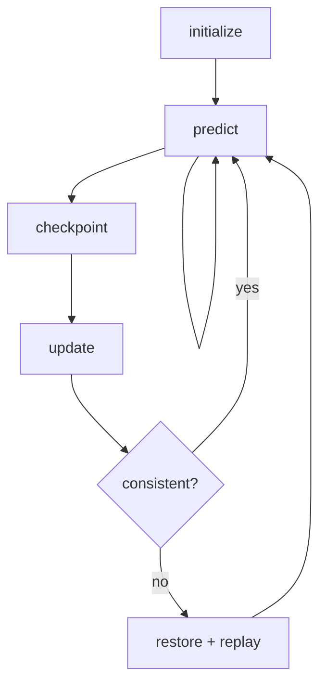

# Kalman engine

> Code is truth — values below describe; YAML/source linked wins on conflict.

Purpose: model-agnostic continuous-discrete extended Kalman filter —
predict/propagate, correct/update, checkpoint, and restore. Pure linear
algebra with no ROS dependency and no rover model. The rover-specific Alpha
ESKF model (`alpha_kalman_filter`: 15-component error state, NIS gating,
rollback/replay) belongs to Systems/Alpha, not here.

Where: `src/localisation/kalman_filter/ekf_continuous_kalman_filter/`
([GitHub](https://github.com/richarJ2002/space_robotics_simulator/blob/main/src/localisation/kalman_filter/ekf_continuous_kalman_filter/));
UKF sibling: `src/localisation/kalman_filter/ukf_continuous_kalman_filter/`
([GitHub](https://github.com/richarJ2002/space_robotics_simulator/blob/main/src/localisation/kalman_filter/ukf_continuous_kalman_filter/)).

Side-by-side UKF (WP1): a model-agnostic continuous-discrete unscented
engine beside the EKF. The caller generates sigma points at the current
state, pushes each point through its own nonlinear process/observation
model, and hands the sigma-point matrices to `predictFromSigmaPoints()` /
`updateFromSigmaPoints()`; the engine performs only the weighted
recombination algebra (scaled unscented transform, explicit `P_yy` /
cross-covariance, `LDLT`-solved gain). `calculateUpdateNis()` scores a
measurement without mutating state so the wrapper can apply the same 99%
chi-square gate values as the EKF. Sigma scaling (`sigma_alpha` default
`1.0e-3`, `sigma_beta` `2.0`, `sigma_kappa` `0.0`) is authoritative in the
Alpha UKF YAML, not here.

## Topics

None — library only. No publishers, no subscriptions, no parameters.

## Key files

| Class / unit | Path | GitHub |
|---|---|---|
| `ContinuousExtendedKalmanFilter` | `src/localisation/kalman_filter/ekf_continuous_kalman_filter/objects/ContinuousExtendedKalmanFilterClass.h` | [link](https://github.com/richarJ2002/space_robotics_simulator/blob/main/src/localisation/kalman_filter/ekf_continuous_kalman_filter/objects/ContinuousExtendedKalmanFilterClass.h) |
| Filter status | `src/localisation/kalman_filter/ekf_continuous_kalman_filter/objects/FilterStatusEnum.h` | [link](https://github.com/richarJ2002/space_robotics_simulator/blob/main/src/localisation/kalman_filter/ekf_continuous_kalman_filter/objects/FilterStatusEnum.h) |
| Predict step | `src/localisation/kalman_filter/ekf_continuous_kalman_filter/methods/predict.cc` | [link](https://github.com/richarJ2002/space_robotics_simulator/blob/main/src/localisation/kalman_filter/ekf_continuous_kalman_filter/methods/predict.cc) |
| Update step | `src/localisation/kalman_filter/ekf_continuous_kalman_filter/methods/update.cc` | [link](https://github.com/richarJ2002/space_robotics_simulator/blob/main/src/localisation/kalman_filter/ekf_continuous_kalman_filter/methods/update.cc) |
| Checkpoint/restore | `src/localisation/kalman_filter/ekf_continuous_kalman_filter/methods/restore.cc` | [link](https://github.com/richarJ2002/space_robotics_simulator/blob/main/src/localisation/kalman_filter/ekf_continuous_kalman_filter/methods/restore.cc) |
| `ContinuousUnscentedKalmanFilter` | `src/localisation/kalman_filter/ukf_continuous_kalman_filter/objects/ContinuousUnscentedKalmanFilterClass.h` | [link](https://github.com/richarJ2002/space_robotics_simulator/blob/main/src/localisation/kalman_filter/ukf_continuous_kalman_filter/objects/ContinuousUnscentedKalmanFilterClass.h) |
| Sigma-point generation | `src/localisation/kalman_filter/ukf_continuous_kalman_filter/methods/generateSigmaPoints.cc` | [link](https://github.com/richarJ2002/space_robotics_simulator/blob/main/src/localisation/kalman_filter/ukf_continuous_kalman_filter/methods/generateSigmaPoints.cc) |
| Unscented predict | `src/localisation/kalman_filter/ukf_continuous_kalman_filter/methods/predictFromSigmaPoints.cc` | [link](https://github.com/richarJ2002/space_robotics_simulator/blob/main/src/localisation/kalman_filter/ukf_continuous_kalman_filter/methods/predictFromSigmaPoints.cc) |
| Unscented update + NIS preview | `src/localisation/kalman_filter/ukf_continuous_kalman_filter/methods/updateFromSigmaPoints.cc` | [link](https://github.com/richarJ2002/space_robotics_simulator/blob/main/src/localisation/kalman_filter/ukf_continuous_kalman_filter/methods/updateFromSigmaPoints.cc) |

No function signatures in v1 — see source.

## Parameters

None at this layer. Tuning (process/measurement noise, gating, replay
horizon) lives in the Alpha ESKF YAML owned by Systems/Alpha.

