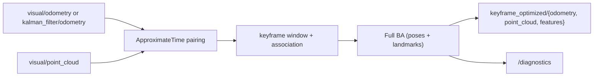

# Keyframe bundle adjustment

> Code is truth — values below describe; YAML/source linked wins on conflict.
> Traceability note only: no JSF AV or ECSS compliance or certification is
> claimed for this module.

Purpose: comparison-only sliding-window keyframe Full bundle adjustment
(poses + landmarks), Eigen-only with no Ceres/g2o. Consumes
source-agnostic keyframes (pose + covariance, no assumed producer) and
refines the window's poses plus landmark positions with Gauss-Newton over
a Schur-complement reduced camera system, with an optional Huber
robustifier on the 3-D point residuals. Outputs are never fused into the
EKF, never gate READY, never broadcast TF, and never re-anchor `map`:
accuracy is compared against the input estimator and ground truth from
bags only.

Where: `src/localisation/keyframe_local_optimization/`
([GitHub](https://github.com/richarJ2002/space_robotics_simulator/blob/main/src/localisation/keyframe_local_optimization/)).

## Topics

| Direction | Name |
|---|---|
| In | `/alpha/localisation/visual/odometry` (`input_source visual`) or `/alpha/localisation/kalman_filter/odometry` (`input_source ekf`) |
| In | `/alpha/localisation/visual/point_cloud` (paired mode only) |
| Out | `/alpha/localisation/keyframe_optimized/odometry` (paired mode only) |
| Out | `/alpha/localisation/keyframe_optimized/point_cloud` (paired mode only) |
| Out | `/alpha/localisation/keyframe_optimized/features` (paired mode only, `--record-images` profile) |
| Out | `/alpha/diagnostics` (`DiagnosticArray` optimizer status) |

Names verified from `KeyframeLocalOptimizationNodeClass.h` topic defaults
(`system_name` rooted, default `alpha`). `ekf` mode is pose-only: the
cloud subscription and `ApproximateTime` pairing are disabled,
`input_cloud_topic` is ignored, and no `point_cloud`/`features` are
published until a fused-cloud source exists. Pose-only keyframes
carry no observations, so the optimizer returns `INSUFFICIENT_DATA`,
`runOptimization()` returns before `publishOdometry()`, and no
`odometry` is published either; diagnostics reports `pose-only idle`
(non-ready, never gating READY). Paired clouds must carry the odom
frame (the VO `publishPointCloud` contract); a foreign `frame_id` is
discarded like a stale pair and never enters the window.
`ground_truth/*` and
`inertial/filtered_imu` are forbidden as inputs. Publishers use
`rclcpp::QoS(10).reliable()` (no `rosbag_qos.yaml` override needed);
subscribers use `SensorDataQoS` mirroring the EKF. No QoS claims beyond
this — see source.

## Key files

| Class / unit | Path | GitHub |
|---|---|---|
| `KeyframeLocalOptimizationNode` | `src/localisation/keyframe_local_optimization/objects/KeyframeLocalOptimizationNodeClass.h` | [link](https://github.com/richarJ2002/space_robotics_simulator/blob/main/src/localisation/keyframe_local_optimization/objects/KeyframeLocalOptimizationNodeClass.h) |
| `KeyframeWindow` | `src/localisation/keyframe_local_optimization/objects/KeyframeWindowClass.h` | [link](https://github.com/richarJ2002/space_robotics_simulator/blob/main/src/localisation/keyframe_local_optimization/objects/KeyframeWindowClass.h) |
| `BundleAdjustmentOptimizer` | `src/localisation/keyframe_local_optimization/objects/BundleAdjustmentOptimizerClass.h` | [link](https://github.com/richarJ2002/space_robotics_simulator/blob/main/src/localisation/keyframe_local_optimization/objects/BundleAdjustmentOptimizerClass.h) |
| Window status | `src/localisation/keyframe_local_optimization/objects/KeyframeLocalOptimizationStatusEnum.h` | [link](https://github.com/richarJ2002/space_robotics_simulator/blob/main/src/localisation/keyframe_local_optimization/objects/KeyframeLocalOptimizationStatusEnum.h) |
| Full BA solve | `src/localisation/keyframe_local_optimization/methods/BundleAdjustmentOptimizer/optimize.cc` | [link](https://github.com/richarJ2002/space_robotics_simulator/blob/main/src/localisation/keyframe_local_optimization/methods/BundleAdjustmentOptimizer/optimize.cc) |
| Pairing callback | `src/localisation/keyframe_local_optimization/methods/KeyframeLocalOptimizationNode/handlePairedInputCallBack.cc` | [link](https://github.com/richarJ2002/space_robotics_simulator/blob/main/src/localisation/keyframe_local_optimization/methods/KeyframeLocalOptimizationNode/handlePairedInputCallBack.cc) |

No function signatures in v1 — see source.

## Parameters

Full authority:
[keyframe_local_optimization.yaml](https://github.com/richarJ2002/space_robotics_simulator/blob/main/parameters/systems/alpha/alpha_localisation/keyframe_local_optimization.yaml).
What each tunes: odom and base frame names; pose producer (`input_source`:
`visual` or `ekf`, default `visual`); optimization trigger
(`trigger_mode`: `count`, `time`, or `offline-first`, with
`trigger_period_s` for `time`); window size in keyframes
(`window_size`, 1..16); Gauss-Newton iterations (`max_iterations`);
Huber switch and transition distance (`use_huber`, `huber_delta_m`);
nearest-neighbour association gate (`association_gate_m`); post-sync age
discard (`maximum_input_age_s`, stale marks the pose unavailable, never
coasts); pairing queue depth (`input_queue_depth`).

## Verification

Pass requires square-bag ATE at or below the visual-input ATE on the same
bag versus ground truth, per-optimization time inside the proposed 100 ms
`RelWithDebInfo` budget on the recorded board/dataset (board: current dev
machine; dataset: square bag), and RPE report-only until its metric tool
lands. No RPE tool is built in this phase; ground truth is never fused.
