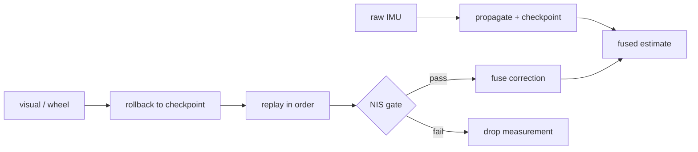

# Alpha localisation filter

> Code is truth — values below describe; YAML/source linked wins on conflict.

Purpose: Alpha's model-specific ESKF wrapper. It fuses raw IMU, visual,
and wheel odometry into one pose/twist estimate, while the reusable linear
algebra lives in the model-agnostic engine.

Where: `src/systems/alpha/alpha_localisation/alpha_kalman_filter/`
([GitHub](https://github.com/richarJ2002/space_robotics_simulator/blob/main/src/systems/alpha/alpha_localisation/alpha_kalman_filter/));
engine: `src/localisation/kalman_filter/`
([GitHub](https://github.com/richarJ2002/space_robotics_simulator/blob/main/src/localisation/kalman_filter/)).

## Topics

| Direction | Name |
|---|---|
| In | `/alpha/imu` |
| In | `/alpha/localisation/visual/odometry` |
| In | `/alpha/localisation/wheel/odometry` |
| Out | `/alpha/localisation/kalman_filter/odometry` |
| Out | `/alpha/localisation/kalman_filter/path` |
| Out | `/alpha/localisation/kalman_filter/wheel_slip_ratio` |
| Out | `/alpha/diagnostics` (`DiagnosticArray` readiness) |

Names verified from `AlphaKalmanFilterNodeClass.h` topic defaults
(`system_name` rooted, default `alpha`). No QoS claims — see source.
Twist is expressed in the child body frame.

## Key files

| Class / unit | Path | GitHub |
|---|---|---|
| `AlphaKalmanFilterNode` | `src/systems/alpha/alpha_localisation/alpha_kalman_filter/objects/AlphaKalmanFilterNodeClass.h` | [link](https://github.com/richarJ2002/space_robotics_simulator/blob/main/src/systems/alpha/alpha_localisation/alpha_kalman_filter/objects/AlphaKalmanFilterNodeClass.h) |
| IMU callback | `src/systems/alpha/alpha_localisation/alpha_kalman_filter/methods/handleImuCallBack.cc` | [link](https://github.com/richarJ2002/space_robotics_simulator/blob/main/src/systems/alpha/alpha_localisation/alpha_kalman_filter/methods/handleImuCallBack.cc) |
| Measurement callback | `src/systems/alpha/alpha_localisation/alpha_kalman_filter/methods/handleMeasurementCallBack.cc` | [link](https://github.com/richarJ2002/space_robotics_simulator/blob/main/src/systems/alpha/alpha_localisation/alpha_kalman_filter/methods/handleMeasurementCallBack.cc) |
| Replay after rollback | `src/systems/alpha/alpha_localisation/alpha_kalman_filter/methods/replayMeasurementsAfter.cc` | [link](https://github.com/richarJ2002/space_robotics_simulator/blob/main/src/systems/alpha/alpha_localisation/alpha_kalman_filter/methods/replayMeasurementsAfter.cc) |

No function signatures in v1 — see source.

## Parameters

Full authority (note the top-level key is `continuous_ekf`, not the
directory name):
[alpha_kalman_filter.yaml](https://github.com/richarJ2002/space_robotics_simulator/blob/main/parameters/systems/alpha/alpha_localisation/alpha_kalman_filter.yaml).
What each group tunes: topic/frame names; prediction rate; measurement age
and future-stamp limits; visual/wheel fusion modes and NIS thresholds
(explicit robustness margin over the automatic chi-square gate — zero
would select it; the threshold moves only the reject boundary, never the
gain); process and measurement
noise variances; readiness thresholds. Never paste numbers as authority —
see the YAML.

## Predict/fuse flow

Raw IMU samples propagate the state; each step is checkpointed, so a
lagged visual or wheel measurement rolls back to the newest checkpoint at
or before its stamp and replays newer records in order. Each correction
passes its source's NIS gate before fusion.

## UKF sibling (comparison-only)

Purpose: an unscented side-by-side with the ESKF for A/B comparison on the
same bags vs ground truth. The ESKF stays the default estimate until a
paired comparison justifies a switch.

Where: `src/systems/alpha/alpha_localisation/alpha_ukf_filter/`
([GitHub](https://github.com/richarJ2002/space_robotics_simulator/blob/main/src/systems/alpha/alpha_localisation/alpha_ukf_filter/));
engine: `src/localisation/kalman_filter/ukf_continuous_kalman_filter/`
([GitHub](https://github.com/richarJ2002/space_robotics_simulator/blob/main/src/localisation/kalman_filter/ukf_continuous_kalman_filter/)).

| Direction | Name |
|---|---|
| In | `/alpha/imu` |
| In | `/alpha/localisation/visual/odometry` |
| In | `/alpha/localisation/wheel/odometry` |
| Out | `/alpha/localisation/ukf/odometry` (recorded CORE) |
| Out | `/alpha/localisation/ukf/path` (never recorded, retained-`Path` policy) |
| Out | `/alpha/diagnostics` (`continuous_ukf[/<source>]`, comparison-only) |

Names verified from `AlphaUkfFilterNodeClass.h` topic defaults
(`system_name` rooted, default `alpha`). QoS mirrors the EKF (odometry
`QoS(10)`, path `QoS(1).reliable().transient_local()`, subs
`SensorDataQoS`); the odometry publisher matches the recorder default so
no `rosbag_qos.yaml` entry is needed. Never TF. Twist is expressed in the
child body frame.

Key files:

| Class / unit | Path | GitHub |
|---|---|---|
| `AlphaUkfFilterNode` | `src/systems/alpha/alpha_localisation/alpha_ukf_filter/objects/AlphaUkfFilterNodeClass.h` | [link](https://github.com/richarJ2002/space_robotics_simulator/blob/main/src/systems/alpha/alpha_localisation/alpha_ukf_filter/objects/AlphaUkfFilterNodeClass.h) |
| IMU callback | `src/systems/alpha/alpha_localisation/alpha_ukf_filter/methods/handleImuCallBack.cc` | [link](https://github.com/richarJ2002/space_robotics_simulator/blob/main/src/systems/alpha/alpha_localisation/alpha_ukf_filter/methods/handleImuCallBack.cc) |
| Measurement callback | `src/systems/alpha/alpha_localisation/alpha_ukf_filter/methods/handleMeasurementCallBack.cc` | [link](https://github.com/richarJ2002/space_robotics_simulator/blob/main/src/systems/alpha/alpha_localisation/alpha_ukf_filter/methods/handleMeasurementCallBack.cc) |
| Sigma-point propagation | `src/systems/alpha/alpha_localisation/alpha_ukf_filter/methods/propagateSigmaPoint.cc` | [link](https://github.com/richarJ2002/space_robotics_simulator/blob/main/src/systems/alpha/alpha_localisation/alpha_ukf_filter/methods/propagateSigmaPoint.cc) |
| Replay after rollback | `src/systems/alpha/alpha_localisation/alpha_ukf_filter/methods/replayMeasurementsAfter.cc` | [link](https://github.com/richarJ2002/space_robotics_simulator/blob/main/src/systems/alpha/alpha_localisation/alpha_ukf_filter/methods/replayMeasurementsAfter.cc) |

No function signatures in v1 — see source.

Parameters: full authority (top-level key `continuous_ukf`):
[alpha_ukf_filter.yaml](https://github.com/richarJ2002/space_robotics_simulator/blob/main/parameters/systems/alpha/alpha_localisation/alpha_ukf_filter.yaml).
Same groups as the EKF plus `sigma_alpha`/`sigma_beta`/`sigma_kappa`
(authoritative values); visual pose mode only (no increment mode), no shock
gate, no TF frames. Never paste numbers as authority — see the YAML.

The UKF state is Euclidean roll/pitch/yaw (not a quaternion) so every
sigma-point operation stays a weighted vector sum; the EKF quaternion is
reconstructed only at publication. `startup_supervisor.yaml` is unchanged:
`continuous_ukf` never gates READY. Its diagnostics share the EKF key set
but are a recorded documented-ignore in `bag_diagnostics.py` until a parser
extension lands.
